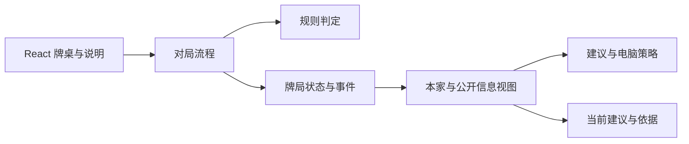

# 架构草图

> 本文记录技术选择与模块边界。当前已有本地可试玩 V1；运行命令见 [README](README.md)。

## 第一阶段技术选择

采用 **TypeScript + React + Vite** 构建浏览器游戏。规则、状态、受限视图和建议共享同一份牌局定义，纯浏览器端即可验证规则正确性、解释质量和教学交互，也可直接静态部署。

| 方案                                    | 对本项目的适用情况                                                                                         |
| --------------------------------------- | ---------------------------------------------------------------------------------------------------------- |
| TypeScript + React + Vite               | 适合先完成浏览器对局、解释性建议和静态部署；本阶段采用。                                                   |
| TypeScript + React/Next.js + PostgreSQL | 适合需要账号、服务端功能和持久数据的阶段。Next.js 也能静态导出，但导出模式无法使用需要运行时服务端的功能。 |
| Python + FastAPI + PostgreSQL           | 适合在线提供复杂策略计算或数据服务；浏览器牌桌仍需单独的前端。                                             |

## 模块边界

`src/components/MahjongTile.tsx` 按常见实体牌面排布以本地 SVG 绘制 27 种万/条/筒牌面与牌背，`PlayerAvatar.tsx` 绘制座位头像；它们只接收展示数据，不参与规则与建议计算。图形在仓库内生成，不依赖远程字体或图片服务。

- **规则判定**：只回答动作是否合法、胡牌和计分结果，不依赖页面组件。
- **对局流程**：管理换三张、定缺、摸打、碰杠胡及血战继续；用固定随机种子复现牌局。
- **建议与电脑策略**：通过 `PlayerView` 读取状态，只能看到本家手牌及公开信息。
- **界面**：展示状态并提交动作，合法性由规则与流程层判定。

引擎另外维护可核查公开元数据：`publicTiles` 保留未被认领弃牌与公开自摸胡张的实际时序；`publicActions` 保留发牌后的完整公开动作（摸牌只记座位不带牌面）；`transfers` 记录每笔实际积分支付与原因。三者均不包含对手暗牌或牌墙顺序。

`decision.ts` 从本家 `PlayerView` 选择托管动作并生成简短解释；`advanceToHuman` 连续推进三名电脑行动至本家决策或结算。`sound.ts` 读取公开动作日志生成中文报牌与分级播报，声音配置存于当前浏览器；牌局状态和最近公开动作日志暂存在页面内存中。详情见 [自动托管与实时建议](docs/AUTOPLAY.md)。

## `src/game/` 内运行时与离线研究模块划分

`src/game/` 目前同时存放浏览器运行时代码和已暂停的离线强度实验模块（由于 `scripts/` 评测脚本会扫描 `src/game/` 计算源码指纹，暂保留在同一目录下，通过下表区分边界）：

| 类别               | 文件                                                                                                                                                                                                                  | 说明                                                                    |
| ------------------ | --------------------------------------------------------------------------------------------------------------------------------------------------------------------------------------------------------------------- | ----------------------------------------------------------------------- |
| **规则与牌局核心** | `tiles.ts`、`rules.ts`、`scoring.ts`、`game.ts`、`view.ts`、`demo.ts`、`session.ts`、`bot.ts`                                                                                                                         | 牌桌状态、规则、流局与电脑对手；页面直接运行                            |
| **教学建议与托管** | `advice.ts`、`actionAdvice.ts`、`lookahead.ts`、`openingAdvice.ts`、`teacher.ts`、`teacherEvaluation.ts`、`decision.ts`                                                                                               | 本家实时建议、两摸对比与托管；页面直接运行                              |
| **V10 生产策略桥** | `advancedComponents.ts`、`v10Response.ts`、`acceptRonTeacher.ts`（以及 `publicSampler.ts` 中的 `publicRonContext`）                                                                                                   | 配合 `src/strategy/`（Worker + Pyodide）运行当前默认 V10 策略           |
| **仅离线研究模块** | `candidateEvaluation.ts`、`immediateWin.ts`、`strongTeacher.ts`、`rolloutTeacher.ts`、`sampledContinuation.ts`、`publicRonContinuation.ts`、`ronContinuationTeacher.ts`、`publicLiability*.ts`、`liabilityDiscard.ts` | 仅用于 `scripts/` 历史对照与实验（含已否定的 V11 原型），**未接入页面** |

## 何时增加服务端

| 需求出现时                                                       | 再评估的技术                                |
| ---------------------------------------------------------------- | ------------------------------------------- |
| 账号、跨设备牌谱和多人共享数据                                   | 服务端 API 与 PostgreSQL                    |
| 浏览器内策略计算经测量无法满足响应时间，或需要模型训练、批量模拟 | Python 计算模块；需要在线调用时再加 FastAPI |
| 需要服务端渲染、服务端路由或其他 Next.js 服务端能力              | Next.js                                     |

## 相关文档

- [docs/PROJECT_PLAN.md](docs/PROJECT_PLAN.md)：产品方向与功能优先级。
- [docs/ENGINEERING.md](docs/ENGINEERING.md)：实现、文档维护与验证流程。
- [docs/research/README.md](docs/research/README.md)：V1–V11 策略强度研究归档。
